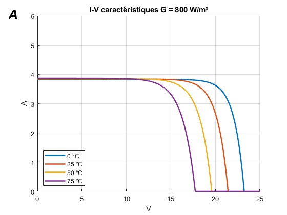
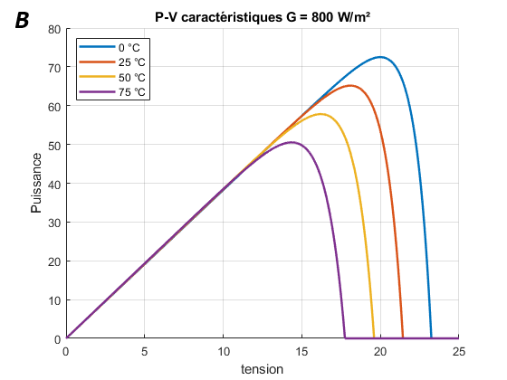
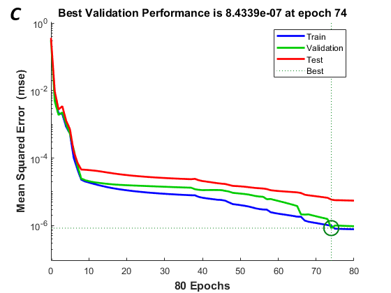
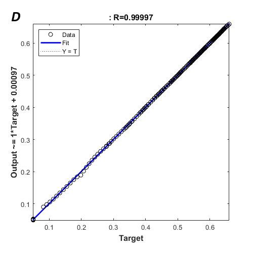

# PV modélisation sous MATLAB avec un commande MPPT piloté par FFNN

### Modélisation du PV sous Simulink:
    -> la modélisation du PV sous simulink `circuit_pv.slx` avec un commande traditionnel MPPT (sur µcontroller)
### Collecte des Données:
    -> le fichier `pv.m` utilise la méthode de Newton-Raphson pour calculer i_pv à chaque pas de temps puis on calcule alpha (le rapport cyclique d'hacheur boost) optimal pour une charge resistif, en fin les donnés sont sotcker sous un fichier .mat.
    N.B: Ce fichier fonctionne comme un modélisation mathématique du pv par methode Newton-raphson, et comme un collecteur des donnés veulliez editer le code selon votre desire.
### training:
    -> fichier `training.m` initialise un réseau des neurones de type FFNN, puis il le entrîane sur les données enrgistrés.

| | |
| :---: | :---: |
|  |  |
|  |  |
*Figure 1: A: I-V charactéristique de notre PV modélisée sous différents température et irradience constant B: P-V charactéristique sous différents températures et un irradience constant C: Performance du FFNN aprés entrînement et D: Resultat du test sur notre network* 

### Rapport:
pour une explication approfondie [rapport](rapport/rapport.pdf)